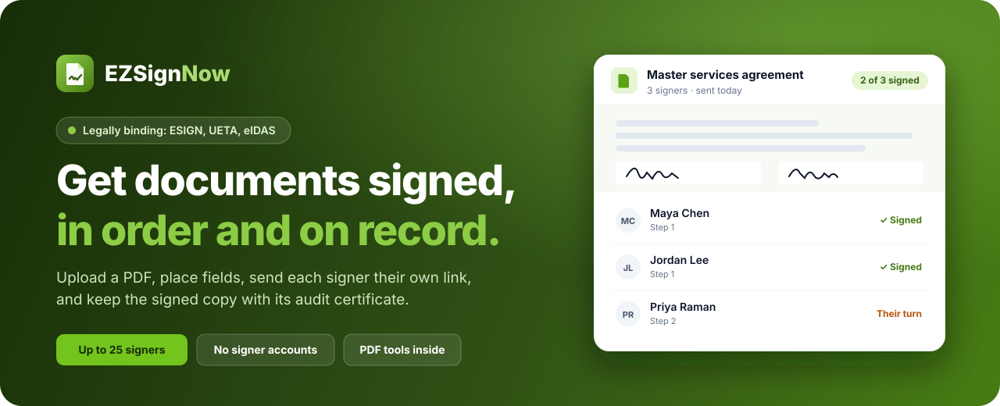
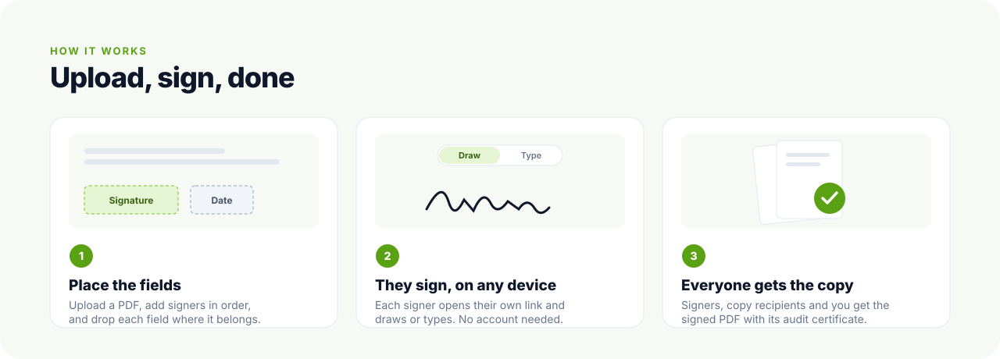
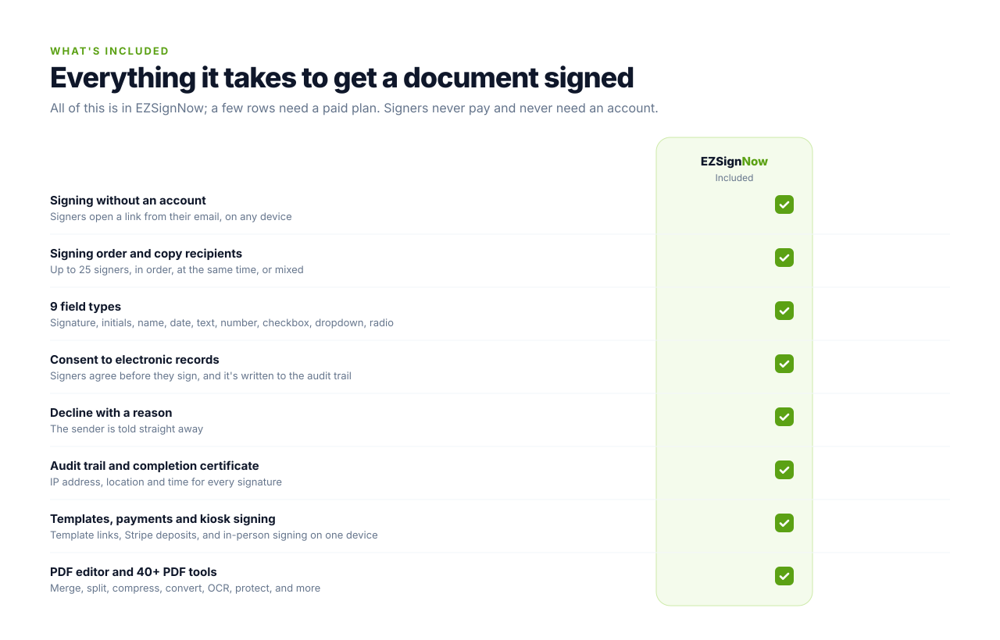

<p align="center">
  
</p>

<p align="center">
  An e-signature app with PDF tools built in.<br>
  Upload a PDF, place fields, send each signer their own link, and keep the signed copy with its audit certificate.
</p>

<p align="center">
  <a href="https://www.ezsignnow.com"><b>Try it at ezsignnow.com</b></a>
</p>

<p align="center">
  <a href="#everything-it-takes-to-get-a-document-signed">Features</a> ·
  <a href="#whats-included">What's included</a> ·
  <a href="#what-it-costs">What it costs</a> ·
  <a href="#get-started">Get started</a> ·
  <a href="#database">Database</a>
</p>

## Why EZSignNow

**Signing that follows your process.** Send to up to 25 signers in the order they sign, have some of them sign at the same time, and copy in people who only need the finished document. Each person is emailed when it's their turn.

**Nothing for signers to set up.** Signers open their own link, agree to sign electronically, and sign by drawing or typing, on any phone, tablet or computer. They never need an account and never pay.

**A record behind every signature.** Each signature is stored with the signer's IP address, location and time, and every view, consent, signature and decline goes into the audit trail. The signed PDF ends with a completion certificate.

**More than signatures.** A PDF editor and 40+ PDF tools come with every account: merge, split, compress, convert, OCR, protect, and chain them into workflows.

## Everything it takes to get a document signed

<p align="center">
  
</p>

### Prepare a document in minutes

Upload a PDF from your computer, Google Drive, OneDrive, Dropbox or Box, then add your recipients:

- **Signers**, up to 25, each with an optional access code.
- **Signing order.** Turn it on to sign step by step. Give two signers the same step number and they sign at the same time, so you can mix the two.
- **Copy recipients**, who never sign and get the finished document.

Then place fields where they belong. Each field belongs to one signer and is required or optional: signature, initials, full name, date signed, text, number, checkbox, dropdown and radio buttons. Add a subject line and a personal note, and send.

### Signing without an account

Each signer gets their own link by email. Before they fill anything in, they read a short electronic records disclosure and agree to it, and that consent goes into the audit trail. Fields from other signers stay visible and locked, and required fields are highlighted until they're done.

Signers can download the document before they sign, or decline with a reason, which stops the document and tells the sender. A signer who opens their link before their step has started sees who it's waiting on.

### Follow every document

The dashboard shows every document with its status (draft, waiting for others, declined, completed or voided) and who it's waiting on, with search and a status filter. Remind the people whose turn it is with one click.

### Sealed copy with an audit certificate

When the last signer finishes, every signer, copy recipient and the sender is emailed. The signed PDF has each signature, initials and field value drawn in place, and a completion certificate listing every signer with their IP address, location and signing time, plus the audit trail.

### Payments, templates and in-person signing

- **Collect a payment** through Stripe as part of signing.
- **Templates** with shareable signing links, so people can fill in and sign without you preparing each one.
- **Kiosk mode** hands one device from signer to signer for in-person signing.

### PDF tools and editor

A PDF editor for text, images, shapes and annotations, and tools to merge, split, reorder, rotate, compress, convert to and from PDF, OCR scanned pages, watermark, add page numbers, protect and unlock. Tools run in the browser.

## What's included

<p align="center">
  
</p>

### The signing loop

| | EZSignNow |
| --- | --- |
| **Signing without an account** | ✅ |
| **Signing order** | ✅ in order, at the same time, or mixed, up to 25 signers |
| **People who only get a copy** | ✅ |
| **Field types** | ✅ signature, initials, name, date, text, number, checkbox, dropdown, radio, each required or optional |
| **Consent to electronic records** | ✅ recorded in the audit trail |
| **Decline with a reason** | ✅ the sender is emailed |
| **Access codes for signers** | ✅ |
| **Audit trail and completion certificate** | ✅ IP address, location and time for every signature |
| **Templates** | ✅ with shareable signing links |
| **Collect a payment** | ✅ Stripe |
| **In-person signing** | ✅ kiosk mode |
| **PDF editor and PDF tools** | ✅ 40+ tools |
| **Phones** | ✅ in the browser |

### Coming next

- Signing deadlines per document, and reminder schedules that run on the server
- An emailed one-time code for signers
- A tamper-evident seal on the signed PDF, and a public page to check a signed copy
- Your organization's name, logo and color on signing pages and emails
- Admin settings: people and roles, who may sign up, how long documents are kept

## What it costs

Signers never pay. Plans are per sender:

| Plan | Monthly | Billed yearly | For |
| --- | --- | --- | --- |
| **Free** | $0 | $0 | 3 documents a month, all field types, audit certificate, PDF tools |
| **Personal Pro** | $3 | $2 a month | Unlimited documents, signing order, templates, access codes, payments |
| **Business** | $5 | $4 a month | Everything in Pro, multiple senders, shared templates, your logo, kiosk signing |

## Get started

### What you need

- Node.js and npm
- A [Supabase](https://supabase.com) project (database, auth and file storage)
- An SMTP mailbox for sending email, for example Zoho Mail
- A [Stripe](https://stripe.com) account, if you want to take payments

### Run it locally

```bash
git clone https://github.com/ezsignnow/EZSignNow.git
cd EZSignNow
npm install
cp .env.example .env   # then fill in your values
npm run dev            # http://localhost:8085, email API included
npm test
```

The `.env` needs your Supabase URL and publishable key, the SMTP settings (`SMTP_HOST`, `SMTP_PORT`, `SMTP_USER`, `SMTP_PASS`, `SMTP_SENDER_NAME`, `SMTP_SENDER_EMAIL`) and, for payments, `STRIPE_SECRET_KEY`. For Stripe payments locally, also run `node server/server.js`.

### Deploy

The site is a static Vite build (`npm run build`, output in `dist/`) and the email and payment endpoints are Vercel functions in `api/`. Deploy the repository to Vercel and add the same environment variables in the project's settings. Without the SMTP variables there, invitations can't be emailed.

## Database

Run the SQL files in `supabase/migrations` in order, in the Supabase SQL editor or with the Supabase CLI.

`20261119_signing_workflow.sql` is optional. Without it, the newer field types are stored as text fields with their real type kept alongside, and everything still works. Two conventions need no schema change:

- `signatories.order_num` is the signing step. Signers who share a step sign at the same time, and `0` marks a copy recipient.
- `signatories.signature_data` holds what the signer entered (signature, initials, field values, consent time, or a decline reason) as JSON. Older rows that hold a bare signature image still work.

## Built with

React, Vite, TypeScript, Tailwind CSS and shadcn/ui on Radix · pdf-lib, PDF.js and Tesseract.js · Supabase · Nodemailer over SMTP · Stripe · Vercel

## License

All rights reserved. EZSignNow.
